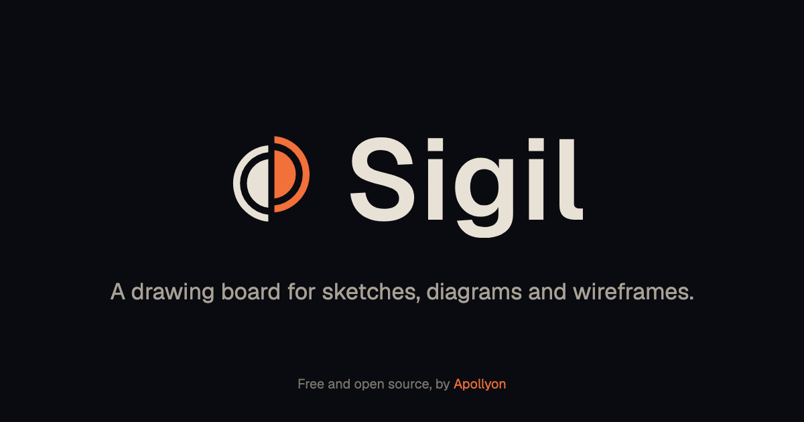

# Sigil

A free, open-source drawing board for sketches, diagrams and wireframes, by [Apollyon](https://apollyoncorp.com).

**Use it: https://sigil.apollyoncorp.com**

<a href="https://sigil.apollyoncorp.com">
  
</a>

## What you can do

- Draw on an infinite canvas in a hand-drawn style, with light and dark themes.
- Save drawings as `.sigil` files, open `.sigil` and `.excalidraw` files, and export images. "Save as .excalidraw" gives a copy you can open in Excalidraw.
- Add ready-made BPMN and flowchart shapes from the main menu ("Add BPMN shapes", "Add flowchart shapes"). They are drawn in Sigil's own hand-drawn stroke and land in your library.
- Search the canvas and run commands from the command palette.

Sigil has no account, no sign-in and no server for your drawings. They stay in your browser until you save them.

## Use it with your AI assistant

[`@apollyoncorp/sigil-mcp`](sigil-mcp/README.md) is an MCP server that lets your own assistant (Claude, Codex, Cursor and others) draw diagrams for Sigil, including BPMN and flowchart shapes and Mermaid conversion. Add it to Claude Code with:

```sh
claude mcp add sigil -- npx -y @apollyoncorp/sigil-mcp
```

Privacy: sigil-mcp only draws and never calls an LLM. Run locally, it never makes a network request: it writes a `.sigil` file on your disk and builds a link that carries the diagram after the `#`, a part the browser never sends to a server.

No install: Apollyon also hosts it at `https://mcp.apollyoncorp.com/mcp` (`claude mcp add --transport http sigil https://mcp.apollyoncorp.com/mcp`). There the diagram passes through Apollyon's server, which does not store it or log its content, and usage is limited per IP. A Claude Code plugin bundles the local server with the `sigil-diagrams` skill: `/plugin marketplace add apollyoncorp/sigil`, then `/plugin install sigil@apollyon`. Setup for other clients and the tool list are in [`sigil-mcp/README.md`](sigil-mcp/README.md).

## Self-hosting

The `Dockerfile` builds the editor and serves it with nginx on port 8080:

```sh
docker build -t sigil .
docker run -p 8080:8080 sigil
```

Then open http://localhost:8080.

Live collaboration, shareable links and the AI backend are off unless you set their environment variables. They are read when the app is built, so set them in `.env.production` before running `docker build`:

| Feature | Variables |
|---|---|
| Live collaboration | `VITE_APP_WS_SERVER_URL` and `VITE_APP_FIREBASE_CONFIG` |
| Shareable links | `VITE_APP_BACKEND_V2_GET_URL`, `VITE_APP_BACKEND_V2_POST_URL` and `VITE_APP_FIREBASE_CONFIG` |
| AI text-to-diagram and wireframe-to-code | `VITE_APP_AI_BACKEND` |

Each feature turns on only when all of its variables are set. Apollyon runs none of these services, so you point them at your own servers. The hosted Sigil has all three off.

For development you need Node 24 and Yarn 1.22. Run `yarn start` to start the dev server on port 3001.

## Support

Sigil is free and Apollyon sells nothing. If it is useful to you, you can [donate](https://donate.stripe.com/dRmfZhdkv9CD1O30Tm2wU00) any amount.

## Credits

Based on [Excalidraw](https://github.com/excalidraw/excalidraw). If you want to support the project Sigil is built on, see the [Excalidraw Open Collective](https://opencollective.com/excalidraw).

## License

MIT, see [`LICENSE`](LICENSE). The fonts bundled with Sigil keep their own licenses, listed in [`NOTICE`](NOTICE).
